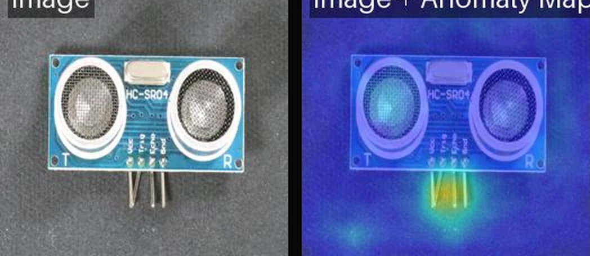

<Note>Jabrod Inspect is in development and is offered through pilots. There is no public download. To discuss a pilot, [book a call](https://jabrod.com/inspect).</Note>

Jabrod Inspect checks photos of the parts you make and tells you which ones need a second look. It is trained on your own parts and runs on a computer at your inspection station. Your images stay on that computer.

Example. Board photo from the VisA dataset (CC BY 4.0). The heatmap marks a bent pin.

## How it works

1. **Show.** You provide photos of good parts, taken at your inspection station.
2. **Learn.** A model learns what a good part looks like. It does not need photos of defects.
3. **Inspect.** Each new photo is compared with what the model learned. Parts that look different are flagged, and the area that differs is marked.

## What you get

| | |
| --- | --- |
| **A model for your part** | Trained on photos of your good parts, then tested on photos it has not seen. |
| **A verdict for every photo** | `OK` or `NEEDS_REVIEW`, with a score, the threshold it was compared against and a heatmap. |
| **A record of every inspection** | Time, verdict, score and model version, kept on your own computer. |
| **An API for your systems** | Your line software sends a photo and receives the result. |

## What it needs

- A fixed camera and steady lighting at the inspection station.
- 100 to 300 photos of good parts.
- A computer at the station. A graphics card is not required.
- Photos of defective parts, if you have them. They are used to test the model and set how strict it is.

## How a pilot works

1. **Call.** You describe the part, the defects you look for and how you inspect today.
2. **Photos.** You share photos of good parts, and of defective ones if you have them.
3. **Test.** A model is trained on your photos and tested on ones it has not seen. You see how many defects it finds and how many good parts it flags.
4. **Decide.** You decide whether to use it on your line, based on those results.

## Questions

<AccordionGroup>
  <Accordion title="What does it look for?">
    Anything that changes how a part looks: a missing or misplaced component, a bent pin, a scratch, a stain. A defect that cannot be seen in the photo cannot be found.
  </Accordion>
  <Accordion title="Do I need photos of defects?">
    No. It learns from good parts. Defect photos, if you have them, are used to test it and set its threshold.
  </Accordion>
  <Accordion title="Does it need the internet?">
    No. It runs on your own computer, and your images stay there.
  </Accordion>
  <Accordion title="Does it replace inspectors?">
    No. It sorts parts into OK and Needs review, so inspectors can look closely at the parts that need it.
  </Accordion>
  <Accordion title="Which industries is it for?">
    Electronics assembly first. Any line where a defect shows in a photo can be tested.
  </Accordion>
</AccordionGroup>

## Next

<CardGroup cols={2}>
  <Card title="Jabrod Inspect" icon="scan-search" href="https://jabrod.com/inspect">The product page, and a link to book a call.</Card>
  <Card title="What you can use today" icon="circle-check" href="/platform/status">Every Jabrod product, and how to start with it.</Card>
</CardGroup>
